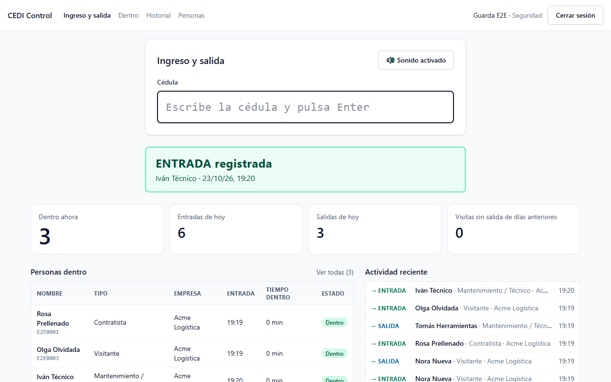
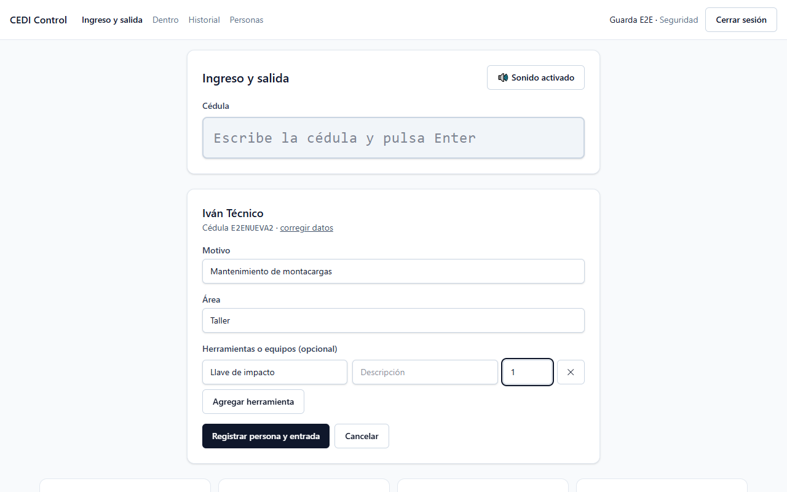
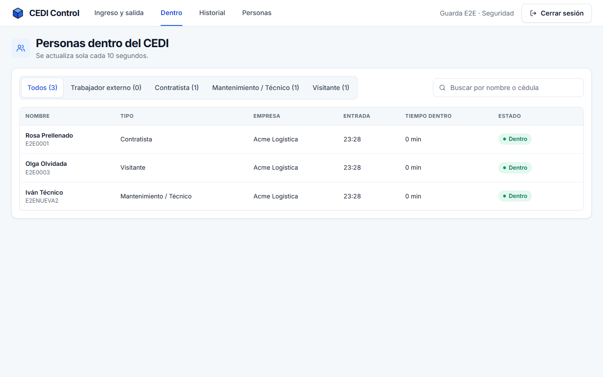
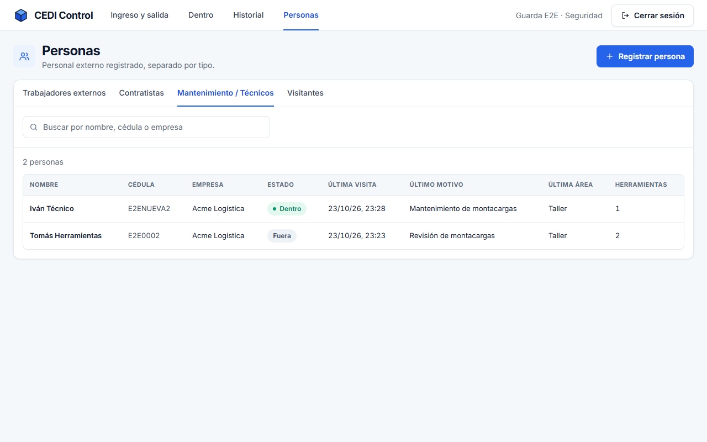
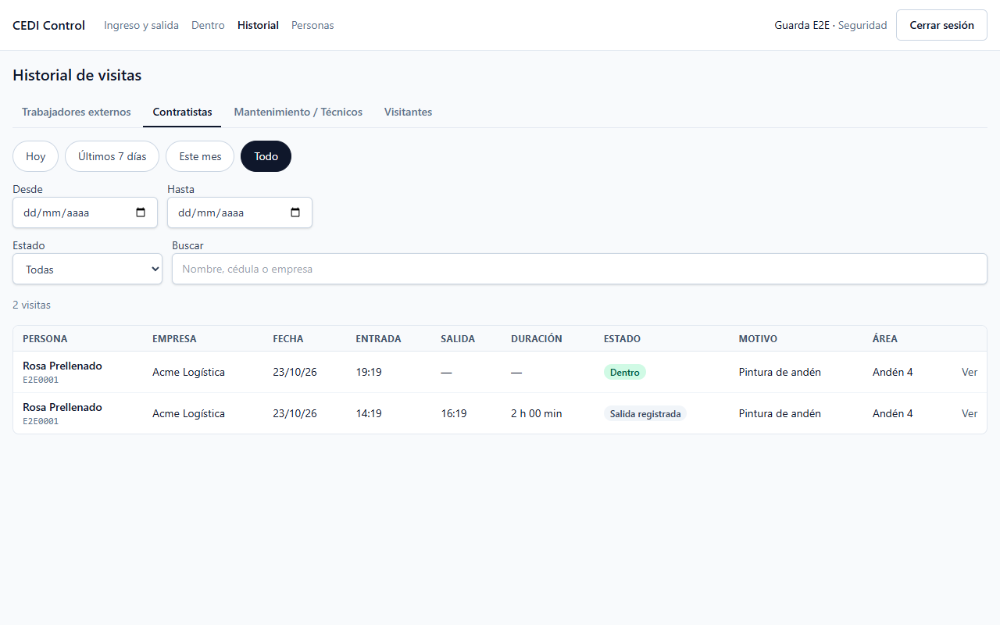
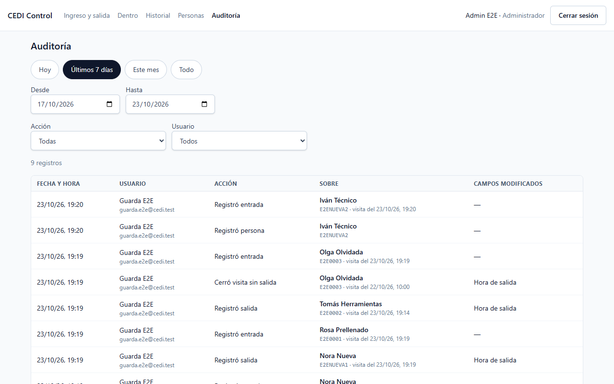
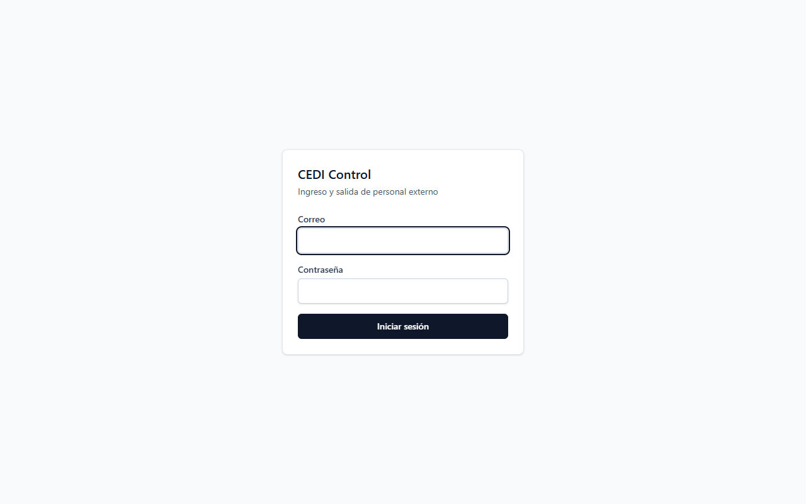

# CEDI Control

Entry and exit control for external staff at a distribution center (CEDI).

The guard types the ID number (_cédula_) of whoever arrives and presses Enter: the system recognizes the person and records their **entry** or **exit** in seconds. If the ID is new, it registers the person together with their first entry.



## Project overview

Every day a distribution center receives workers from other companies, contractors, maintenance technicians and visitors. Without a system, knowing who is inside, since when and with which tools depends on paper logbooks.

CEDI Control centralizes that record:

- Each person is registered once.
- Each time they come in is a visit with an entry and an exit time.
- The guard always sees who is inside.
- The administrator can audit every change.

It is an internal web app with two roles: **Security** (the guard at the gatehouse) and **Administrator**. There is no public sign-up.

The user interface is in Spanish. Terms used in this README and in the screens:

| Term             | Meaning                                                               |
| ---------------- | --------------------------------------------------------------------- |
| CEDI             | _Centro de distribución_: distribution center                         |
| Cédula           | National ID number; it identifies the person (there are no badges)    |
| Caseta           | Gatehouse where the guard works; several can operate at the same time |
| Ingreso y salida | Entry and exit: the main screen                                       |
| Dentro           | Inside: people currently in the CEDI                                  |
| Historial        | Visit history                                                         |
| Personas         | People: registered persons by type                                    |
| Auditoría        | Audit log (administrators only)                                       |
| Seguridad        | Security role (guard)                                                 |
| Person types     | External worker, contractor, maintenance / technician, visitor        |

## Screenshots

|                                                                                     |                                                                 |
| ----------------------------------------------------------------------------------- | --------------------------------------------------------------- |
|  |        |
| **New person** — a technician registered with their first entry and tools           | **Inside** — who is in the CEDI and for how long                |
|                         |            |
| **People** — records by person type, accent-insensitive search                      | **History** — visits by type with date, status and text filters |
|                                      |                          |
| **Audit log** — who did what and when (administrators only)                         | **Login**                                                       |

Screenshots are generated from test data with `npm run screenshots`.

## Features

- **Entry and exit by ID number**, designed for a keyboard-style scanner or manual typing:
  - If the person is inside, their exit is recorded automatically.
  - If they are outside, their entry is recorded; an external worker only needs Enter.
  - If the ID is new, the person and their first entry are registered in a single operation.
- **Data by person type:** contractors, technicians and visitors give a purpose and an area (prefilled from their previous visit); technicians can register tools, which the system reminds the guard to check on exit.
- **Protection against operating mistakes:**
  - Asks for confirmation on a double scan (less than 60 s apart).
  - Detects forgotten visits from previous days and lets them be closed with the real exit time.
  - Never allows two open entries for the same person, even with several gatehouses at once.
- **Dashboard:** who is inside, today's entries and exits, forgotten visits and recent activity; refreshes every 10 seconds.
- **History** split by person type, with filters by date, status and search.
- **People:** person records, accent-insensitive search, companies without duplicates. Only an administrator can correct a name or ID number.
- **Audit log** for administrators only: who did what and when, without storing sensitive values.
- **Accessible and responsive:**
  - WCAG 2.1 AA checked automatically.
  - Works with the keyboard, on desktop, laptop and tablet.
  - Optional sound for entry, exit and error.

## Tech stack

| Layer      | Technology                                                                    | Why                                                                                 |
| ---------- | ----------------------------------------------------------------------------- | ----------------------------------------------------------------------------------- |
| Language   | Strict TypeScript, Node.js ≥ 22.12                                            | One language and shared types across web and API                                    |
| API        | NestJS 11                                                                     | Native modules, dependency injection and role guards                                |
| Data       | PostgreSQL 17 + Prisma 7                                                      | Partial indexes, `CHECK` constraints and trigram search; versioned migrations       |
| Validation | Zod 4 (shared package)                                                        | The same schema validates the form and the API                                      |
| Web        | React 19, Vite 8, React Router 7, TanStack Query, React Hook Form, Tailwind 4 | Mature tooling, cached live polling and typed forms                                 |
| Security   | argon2id, JWT in an `httpOnly` cookie, helmet, rate limiting                  | See [`docs/security.md`](docs/security.md)                                          |
| Testing    | Vitest, Supertest, Playwright, axe                                            | Unit, integration against real PostgreSQL, and E2E with accessibility checks        |
| Delivery   | Multi-stage Docker, GitHub Actions                                            | Reproducible image and CI with lint, types, tests, coverage and supply-chain checks |

## Architecture

TypeScript monorepo (npm workspaces) with three packages:

- **`packages/shared`** — types, enums and Zod schemas: a single source of validation for web and API.
- **`apps/api`** — NestJS REST API, organized by module (`auth`, `persons`, `companies`, `visits`, `dashboard`, `audit`, `health`): controller (HTTP and validation) → service (business rules) → repository (data access). Authentication and roles are enforced by global guards; auditing is cross-cutting.
- **`apps/web`** — React SPA organized by feature (`scan`, `persons`, `history`, `dashboard`, `audit`) with Atomic Design (atoms, molecules, organisms, templates). Components contain no business rules; logic lives in hooks and functions tested separately.
- **Production:** a single container where the API also serves the built web app (same origin), plus PostgreSQL.

The requirements are in [`docs/requirements.md`](docs/requirements.md), the design in [`docs/architecture.md`](docs/architecture.md) and each significant decision in an ADR under [`docs/decisions/`](docs/decisions/README.md); [`docs/README.md`](docs/README.md) is the index, and [`CHANGELOG.md`](CHANGELOG.md) summarizes how the project evolved.

## Project structure

```
apps/
  api/
    prisma/          Schema, migrations (with hand-written SQL sections) and seed
    scripts/         Terminal tools: users, demo:setup, database user, E2E preparation
    src/             NestJS modules (auth, persons, companies, visits, dashboard, audit, health…)
    test/            HTTP tests and integration tests against PostgreSQL
  web/
    src/
      components/    Atomic Design: atoms, molecules, organisms, templates
      features/      Hooks and components per feature (scan, persons, history, dashboard, audit…)
      pages/         Routed screens
      lib/           Formatting, API client and other tested helpers
packages/
  shared/            Shared enums, Zod schemas and domain helpers
e2e/                 Playwright tests (gatehouse flow, roles, accessibility, responsive, screenshots)
docs/                Requirements, architecture, ADRs, security, testing and screenshots
docker/              PostgreSQL init scripts
.github/             CI workflow and Dependabot configuration
Dockerfile, docker-compose.yml, docker-compose.prod.yml
```

## Prerequisites

- **Node.js ≥ 22.12** and **npm**
- **Docker** (for PostgreSQL)

## Getting started

```bash
git clone https://github.com/Aaron23486/dcontrol.git
cd dcontrol
cp .env.example .env      # then fill in the values (see Environment configuration)
npm ci                    # exact versions from package-lock.json; also builds the shared package and the Prisma client
npm run db:up             # PostgreSQL in Docker (also creates the test database)
npm run db:deploy         # applies migrations and creates the API's database user (no admin privileges)
npm run demo:setup        # demo accounts (one per role) and fictitious data
npm run dev               # API on :3000 and web on http://localhost:5173
```

Then sign in with one of the demo accounts printed by `demo:setup` (see [Authentication and demo access](#authentication-and-demo-access)).

## Environment configuration

All variables are documented in [`.env.example`](.env.example). The API validates them at startup and refuses to start if any is missing.

| Variable                                                             | Purpose                                                                                                                                     |
| -------------------------------------------------------------------- | ------------------------------------------------------------------------------------------------------------------------------------------- |
| `POSTGRES_USER`, `POSTGRES_PASSWORD`, `POSTGRES_DB`, `POSTGRES_PORT` | docker-compose database                                                                                                                     |
| `DATABASE_URL`                                                       | API connection to PostgreSQL, with an unprivileged user created by `db:deploy` (ADR 0012)                                                   |
| `MIGRATION_DATABASE_URL`                                             | The table owner: used only to apply migrations (`db:deploy`, `db:migrate`)                                                                  |
| `DATABASE_URL_TEST`                                                  | Dedicated database for integration and E2E tests (it is wiped)                                                                              |
| `JWT_SECRET`                                                         | Session signing key, at least 32 characters. Generate with `node -e "console.log(require('crypto').randomBytes(48).toString('base64url'))"` |
| `SESSION_TTL_HOURS`                                                  | Session length (12 h, one shift)                                                                                                            |
| `WEB_ORIGIN`                                                         | Web app URL (CORS)                                                                                                                          |
| `CEDI_TIMEZONE`                                                      | IANA time zone of the CEDI: defines what "today" is                                                                                         |
| `LOGIN_RATE_LIMIT_PER_MINUTE`                                        | Login attempts per IP per minute                                                                                                            |
| `API_RATE_LIMIT_PER_MINUTE`                                          | Requests per minute to the whole API, per user (or per IP without a session) (ADR 0014)                                                     |
| `LOGIN_MAX_FAILURES_PER_ACCOUNT`, `LOGIN_LOCKOUT_MINUTES`            | Temporary lockout of an email after several consecutive failed attempts (ADR 0013)                                                          |
| `SECURITY_ALERT_FAILED_LOGINS`                                       | Failed logins within 10 minutes that trigger the `security.alert` log event (ADR 0013)                                                      |
| `API_PORT` / `PORT`                                                  | API port                                                                                                                                    |
| `WEB_DIST_DIR`, `TRUST_PROXY`                                        | Production: built web folder and running behind an HTTPS proxy                                                                              |
| `E2E_BROWSER_CHANNEL`                                                | Optional: `chrome` or `msedge` to run E2E tests with the installed browser                                                                  |

Never commit `.env`.

## Database setup

```
companies 1──N persons 1──N visits 1──N visit_tools
companies 1──N visits          (company at the time of entry)
users     1──N visits          (who recorded the entry and the exit)
users     1──N audit_logs
```

| Table         | Content                                                                                                                     |
| ------------- | --------------------------------------------------------------------------------------------------------------------------- |
| `persons`     | Name, ID number (unique and normalized), type and current company                                                           |
| `visits`      | Each time a person comes in: entry and exit times, who recorded them, type and company **at that moment**, purpose and area |
| `visit_tools` | Tools a technician brings in on a visit                                                                                     |
| `companies`   | Companies with a unique normalized name ("Acme S.A." = "ACME SA")                                                           |
| `users`       | Accounts (Security or Administrator) with an argon2id password                                                              |
| `audit_logs`  | Who, which action, on which record and which fields changed (never values)                                                  |

Rules enforced by the database, not only by the code:

- **A person never has two open visits:** partial unique index `WHERE exit_at IS NULL`.
- The exit is not earlier than the entry.
- Whoever recorded the exit exists if and only if there is an exit time.
- Purpose and area are present according to the person type.
- The ID number is unique and normalized.

```bash
npm run db:deploy    # pending migrations + API database user (development and production)
npm run db:migrate   # creates a new migration after changing schema.prisma (development only)
npm run db:seed      # demo companies (creates no users; refuses to run in production)
```

Some constraints (partial index, `CHECK`, the `pg_trgm` extension) are written in SQL inside the migrations because Prisma cannot express them; they must be kept. Full details in [`docs/architecture.md`](docs/architecture.md#data-model) and [`apps/api/prisma/schema.prisma`](apps/api/prisma/schema.prisma).

## Authentication and demo access

There are two roles, **Security** and **Administrator**, with no public sign-up and no OAuth. The audit log is visible only to administrators.

**Demo access (local):**

```bash
npm run demo:setup
```

It creates `seguridad@demo.cedi.test` (Security) and `admin@demo.cedi.test` (Administrator) with generated passwords that are **printed only once**, plus 10 fictitious people of the four types and 14 visits (people inside, history, a forgotten visit, a technician with tools) with their audit trail. Running it again issues new passwords and never duplicates the data. It refuses to run with `NODE_ENV=production` ([ADR 0016](docs/decisions/0016-demo-access.md)).

**Real installation:** there is no user-management screen; accounts are managed from the server terminal ([ADR 0008](docs/decisions/0008-id-number-identification.md)):

```bash
npm run create-admin                            # first administrator (asks for the details)
npm run users -- create                         # a guard (Security role)
npm run users -- list
npm run users -- deactivate <email>             # revokes access and closes their sessions
npm run users -- activate <email>
npm run users -- reset-password <email>         # also closes their open sessions
```

`create-admin` also accepts `ADMIN_NAME`, `ADMIN_EMAIL` and `ADMIN_PASSWORD` as environment variables. These commands never print the password.

## Running locally

**Development**

```bash
npm run dev          # API (watch mode) + web (Vite) in parallel
```

**Production with Docker**

```bash
docker compose -f docker-compose.prod.yml --env-file .env up -d --build
docker compose -f docker-compose.prod.yml exec app npm run create-admin
```

The app runs on `http://localhost:8080` (`APP_PORT`). Before it starts, the `migrate` service applies the migrations as the table owner and creates the API's database user (`APP_DB_USER`, `APP_DB_PASSWORD`), which has no admin privileges (ADR 0012). The app exposes `GET /api/health` for health checks. On another platform, run `npm run db:deploy` as a pre-deploy step. On a real server, serve it behind HTTPS with `TRUST_PROXY=true`. The image runs on any platform that accepts Docker.

## Testing and quality checks

```bash
npm run lint && npm run typecheck && npm run format:check
npm test                    # unit tests
npm run test:integration    # against real PostgreSQL (requires db:up)
npm run test:e2e            # Playwright: gatehouse flow, roles, accessibility, tablet
npm run test:coverage       # unit + integration with minimum coverage thresholds
```

- **347 automated tests:** 202 unit, 126 integration against PostgreSQL 17 and 19 end-to-end (Playwright, with axe accessibility checks).
- **Coverage:** API ≈ 98 % of lines; web logic ≈ 92 %. CI fails below the thresholds.
- Which test covers each business rule: [`docs/testing.md`](docs/testing.md).
- **CI (GitHub Actions)** on every pull request: formatting, lint, types, unit, integration and E2E tests, coverage, build, `npm audit` and gitleaks secret scanning over the whole history. Actions are pinned by commit and Dependabot proposes weekly updates as reviewable pull requests (ADR 0015).

## Security

- Passwords hashed with **argon2id**; login with generic messages, constant time, a per-IP attempt limit and a temporary lockout per email.
- Session in an `httpOnly`, `SameSite=Strict` cookie, `Secure` in production. Role and account status are checked on every request. Changing the password or deactivating the account closes open sessions.
- Role-based authorization on every endpoint (everything requires a session except login, logout and health); the audit log is for administrators only.
- All input validated on the server with the shared schemas; parameterized queries (Prisma).
- The API connects with a database role without admin privileges, `DELETE` or DDL (ADR 0012).
- Errors without internal details; security headers (strict CSP, HSTS…); restricted CORS.
- Logs without cookies, passwords or search text; the audit log stores field names, not values.
- Secrets only in environment variables; unprivileged container; no known vulnerabilities in dependencies at the time of writing.

Details, known limitations and deployment recommendations: [`docs/security.md`](docs/security.md).

## Engineering decisions

The choices I consider most important, each with its decision record:

- **The ID number identifies the person** (there are no badges), normalized so that `1-234-567` and `1234567` are the same ([ADR 0008](docs/decisions/0008-id-number-identification.md)).
- **Person and visit are separate:** fixed data is stored once. Each visit keeps the type and company of that moment, so the history does not change if someone moves to another company.
- **Fields by person type**, enforced by the database ([ADR 0009](docs/decisions/0009-fields-by-person-type.md)).
- **Critical rules in the database:** the partial index prevents two open visits even with several gatehouses at once ([ADR 0002](docs/decisions/0002-single-open-visit.md)).
- **Computed state, not stored:** "inside" means `exit_at IS NULL`. Timestamps are stored in UTC and "today" is computed in the CEDI's time zone ([ADR 0003](docs/decisions/0003-computed-visit-status.md)).
- **`httpOnly` cookie session verified on every request:** deactivating an account cuts access immediately ([ADR 0004](docs/decisions/0004-authentication-and-session.md)).
- **Scanner behind an interface:** a keyboard or keyboard-style scanner today, a camera tomorrow, without a redesign ([ADR 0006](docs/decisions/0006-scanner-and-scan-operation.md)).
- **Polling every 10 s** instead of WebSockets: enough for a gatehouse, with no extra infrastructure ([ADR 0005](docs/decisions/0005-polling-for-live-data.md)).
- **A single container in production** ([ADR 0010](docs/decisions/0010-single-container-deployment.md)).
- **Own design system:** colors, radii and shadows as tokens in a single file, self-hosted Inter font and custom SVG icons, no component library. On desktop, the entry and exit screen fits entirely in the window ([ADR 0011](docs/decisions/0011-design-system.md)).
- **Reproducible demo access** with generated passwords instead of fixed credentials in the documentation ([ADR 0016](docs/decisions/0016-demo-access.md)).

## Known limitations

- **Signing out closes every session of that account**, including another gatehouse using the same account. It is the cost of revoking without storing each session; with one account per guard it has no effect.
- **No inactivity timeout** (accepted risk, ADR 0014): the session lasts a fixed 12-hour shift. The gatehouse screen refreshes every 10 s, so the server cannot tell an idle gatehouse from an attended one; signing out at shift change is part of the procedure.
- **Rate limiting, the per-email lockout and the security alert live in each instance's memory.** They reset with the API and, with several replicas, each counts separately; horizontal scaling would need a shared store such as Redis.
- **The per-email lockout can be triggered on purpose:** someone who knows a guard's email can lock it for 15 minutes. It is logged (`auth.account_locked`) and expires on its own (ADR 0013).
- **The common-password list is short and local:** it does not query breached-password databases; the 12-character minimum does most of the work.
- **Account changes made from the terminal are not in the app's audit log**, because no app user makes them (ADR 0008); they remain in the server's terminal history.

Possible future improvements:

- Reading the ID with a tablet **camera** (a new `ScannerSource` implementation).
- **Exporting** the history to CSV or Excel for reports.
- A **user-management screen** for administrators, if the terminal commands stop being enough.
- **Live updates with SSE** instead of 10-second polling, if the number of gatehouses grows.
- A **shared rate limit** (Redis) to run several API replicas.
- An **area catalog** to normalize the "area" field.

## License

[MIT](LICENSE) © 2026 Aaron23486
